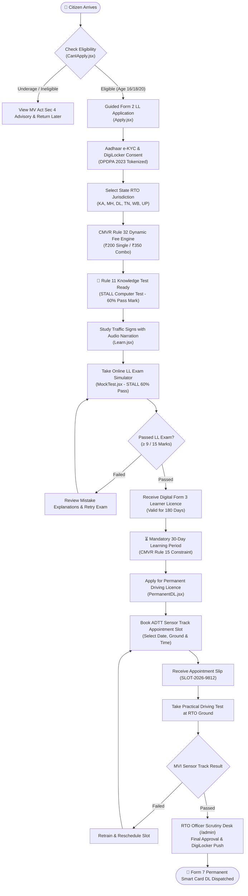

# 🇮🇳 Licence Saathi | EasyDL — MARK-III Mparivahan
### *A Friction-Free, AI-Powered Nationwide Driving Licence Companion for India*

[](https://hackcache26-mark-iii-mparivahan.vercel.app/)
[](https://github.com/avrojitsaha763-byte/Hackcache26_MARK-III_Mparivahan)
[](https://parivahan.gov.in)
[](https://www.meity.gov.in/)
[](http://localhost:8000/docs)
[](https://react.dev/)

---

## 👥 Team Identity & Perspective Roles

**Team Name:** **Licence Saathi (MARK-III Innovators)**  
**Hackathon:** **Hackcache26 — Problem Track: MARK-III Mparivahan**  
**Project Lead:** **ARITRA ROY**  

```text
┌────────────────────────────────────────────────────────────────────────────────────────┐
│                      TEAM LICENCE SAATHI (MARK-III INNOVATORS)                         │
└──────────────────────────────────────────┬─────────────────────────────────────────────┘
                                           │
         ┌─────────────────────────────────┼─────────────────────────────────┐
         ▼                                 ▼                                 ▼
┌──────────────────────────────┐ ┌──────────────────────────────┐ ┌──────────────────────────────┐
│         ARITRA ROY           │ │        AVROJIT SAHA          │ │       SHUBHAM MALAKAR        │
│ Project Lead & Backend       │ │ Core Frontend & Cloud        │ │ Data Architect & UI/UX       │
│ Systems Architect            │ │ Architect                    │ │ Feature Engineer             │
├──────────────────────────────┤ ├──────────────────────────────┤ ├──────────────────────────────┤
│ • Overarching project        │ │ • Mobile-first UI/UX in      │ │ • Master statutory datasets  │
│   leadership & architecture  │   React 19 & Tailwind CSS      │   in src/data/ (config,        │
│ • FastAPI microservice       │ • 12 Core Parivahan features   │   signs, questions)            │
│   (Backend/main.py, port     │ • RTO Scrutiny Portal (/admin) │ • Multi-vehicle taxonomy       │
│   8000) with 5 RTO endpoints │ • 24/7 Saathi AI Chatbot       │   (Bikes, Cars, Combos, Cab)   │
│ • Dual-mode Supabase DB with │ • Interactive ADTT appointment │ • CMVR Rule 32 fee matrix      │
│   resilient offline mock     │   slot booking with slip gen   │ • ADTT test track sensor data  │
│   fallbacks                  │ • Rule 11 test guidance alerts │ • State RTO policy matrix      │
│ • MoRTH statutory compliance │ • Web Speech API bilingual TTS │ • Accessibility design tokens  │
└──────────────────────────────┘ └──────────────────────────────┘ └──────────────────────────────┘
```

---

## 📌 Problem Statement (In Brief) & Elaborate Detailed Solution

### ⚠️ The Problem Statement (from [CachedInfo Hackcache](https://cachedinfo.in/hackcache/problems/mparivahan-driving-licence))
Navigating India's driving licence system under the **Ministry of Road Transport and Highways (MoRTH)** and NIC's **Parivahan / Sarathi** portal is traditionally an intimidating, confusing experience for citizens:
- **Legal Complexity & Jargon:** Ordinary citizens struggle to comprehend statutory rules under the **Motor Vehicles Act 1988** and **Central Motor Vehicles Rules (CMVR) 1989** (e.g., minimum age requirements per Class of Vehicle, Form 1 vs. Form 1-A medical certificates, and the mandatory 30-day waiting period under Rule 15).
- **Knowledge Test & State Procedures:** Applicants are often confused by preliminary test requirements under **CMVR 1989 Rule 11** (requiring a 60% qualifying score on computer knowledge tests covering road signs, regulations, and driver duties) and state-specific slot scheduling windows.
- **Desktop-Centric & Text-Heavy Interfaces:** Most government portals are designed for high-resolution desktop monitors and fail on low-cost smartphones with small viewports or spotty internet.
- **Lack of Interactive Preparation:** Official question banks and traffic signs are provided in static, unwieldy PDFs without interactive testing, phonetic pronunciation, or clear explanations.
- **Touts and Middlemen Exploitation:** The lack of transparent timeline tracking and fee transparency leads citizens to rely on unofficial agents who charge excessive fees.

---

### 💡 Our Elaborate, Detailed Solution: Licence Saathi (EasyDL)
**Licence Saathi** redesigns the entire end-to-end citizen driving licence journey from scratch into a modern, mobile-first, high-empathy web application that guides users step-by-step:
1. **Interactive Multi-Vehicle Eligibility Wizard (`/can-i-apply`):** Explains statutory eligibility in plain language for 6 vehicle classes (Bikes, Cars, Combos, and Commercial Transport) with instant MV Act Section 4 age validation.
2. **Guided Form 2 LL Application with DigiLocker e-KYC (`/apply`):** Step-by-step progressive form with automatic state jurisdiction selection, CMVR Rule 32 dynamic fee calculation, and tokenized paperless Aadhaar e-KYC under **DPDPA 2023** (zero raw biometric/UID storage).
3. **Audio-Guided Traffic Sign Flashcards (`/learn`):** Interactive vector traffic signs categorized into Mandatory, Warning, and Informatory, featuring **Web Speech API text-to-speech** in both English and Hindi.
4. **STALL Exam Simulator (`/mock-test`):** Timed computer-based test interface (15 questions, 30s timer, 60% pass threshold) with bilingual question delivery and question-by-question explanations.
5. **Transparent Timeline & Statutory Guidance (`/track`):** Real-time 4-stage tracking visualizer with CMVR Rule 11 knowledge test requirements, passing score benchmarks, and direct next-step CTAs.
6. **Interactive ADTT Appointment Slot Booking (`/permanent-dl`):** Enforces CMVR Rule 15 (minimum 30-day wait), offers real-time slot selection across state automated test grounds, and generates official appointment confirmation slips (`SLOT-2026-9812`).
7. **RTO Official Scrutiny Desk (`/admin`):** Complete administrative portal for licensing officers to scrutinize incoming applications, inspect DigiLocker documents, approve/reject, and issue digital Form 3 / Form 7 licences.
8. **24/7 Saathi AI Citizen Assistant Chatbot:** Accessible floating assistant answering common questions about fees, rules, penalties, and test tips in conversational English and Hindi.

---

## 🌟 Why We Stand Out: Uniqueness, Innovativeness, Creativeness & Interactiveness

| Dimension | Standard Government Portals / Existing Web Guides | 🚀 Licence Saathi (EasyDL) |
| :--- | :--- | :--- |
| **User Experience (UX)** | Cluttered, dense tables, desktop-oriented, requires zooming on mobile. | **Mobile-First 360px viewport optimization** with fluid Framer Motion transitions and touch-friendly targets. |
| **Language & Accessibility** | Legalistic bureaucratic jargon, largely static English/Hindi text. | **Bilingual Toggle (English & Hindi)** with integrated **Web Speech API audio narration** for traffic signs. |
| **Statutory Safeguards** | Zero warning regarding application cancellation windows. | **CMVR Rule 11 60% knowledge test guidance** and **CMVR Rule 15 30-day earliest test date calculator**. |
| **Fee Transparency** | Static PDF circulars with hidden or confusing breakdowns. | **Dynamic CMVR Rule 32 Fee Engine** that automatically splits costs for Single vs. Dual Bike+Car classes. |
| **Learning & Mock Testing** | Static 50-page question PDFs with answers in an appendix. | **Interactive, timed STALL simulator** with real-time scorecards and official rationale for each option. |
| **Appointment Booking** | External, complex calendar forms with frequent CAPTCHA timeouts. | **Integrated ADTT Slot Picker** with instant digital appointment slip generation. |
| **Official Scrutiny Loop** | Black-box backend where citizens have no clue what officers see. | **Dedicated RTO Scrutiny Portal (`/admin`)** allowing evaluators to see the complete official verification cycle. |
| **Citizen Helpdesk** | Non-responsive toll-free numbers or static FAQs. | **24/7 Floating Saathi AI Assistant** providing instant statutory guidance with one-tap prompt chips. |

---

## 🔄 Citizen Working Procedure Flowchart (Mermaid)

The flowchart below visualizes the seamless end-to-end journey from registration to permanent driving licence delivery:



---

## 🏗️ Technical Architecture & Pipeline Block Diagram (Mermaid)

Licence Saathi is constructed using an enterprise-grade **3-Tier Cloud Architecture**:

```mermaid
graph TB
    subgraph PresentationTier [Tier 1: Presentation & Client Layer (Mobile-First 360px)]
      ViteApp["React 19 + Vite 8 SPA"]
      FramerMotion["Framer Motion + Lucide Icons"]
      TTS["Web Speech API (Bilingual Narration)"]
      Chatbot["Saathi AI Citizen Assistant (ChatbotModal)"]
      AdminDesk["RTO Official Scrutiny Portal (AdminPortal)"]
      StickyState["Secure Sticky State & LocalStorage Synchronization"]
    end

    subgraph ServiceTier [Tier 2: Business Logic & Microservices (FastAPI & Node)]
      FastAPIServer(("FastAPI REST Microservice (Port 8000)"))
      EligibilityRoute["POST /api/check-eligibility"]
      TrackingRoute["GET /api/applications/{app_no}"]
      QuizRoute["POST /api/quiz/submit"]
      QuestionsRoute["GET /api/questions"]
      ParivahanAdapter(("NIC Sarathi Parivahan API Gateway"))
      DigiLockerAdapter(("DigiLocker & UIDAI Tokenized Adapter"))
      PaymentEngine(("CMVR Rule 32 Dynamic Fee Calculator"))
    end

    subgraph DataTier [Tier 3: Persistence & Compliance Storage]
      PostgreSQL[("Supabase Cloud Database (PostgreSQL with RLS)")]
      StaticData[("Master Statutory Datasets (src/data/config.json)")]
      AuditVault[("DPDPA 2023 Consent & Audit Log Store")]
    end

    ViteApp --> StickyState
    ViteApp --> TTS
    ViteApp --> Chatbot
    ViteApp --> AdminDesk
    ViteApp --> FastAPIServer
    AdminDesk --> FastAPIServer
    Chatbot --> FastAPIServer

    FastAPIServer --> EligibilityRoute
    FastAPIServer --> TrackingRoute
    FastAPIServer --> QuizRoute
    FastAPIServer --> QuestionsRoute
    FastAPIServer --> ParivahanAdapter
    FastAPIServer --> DigiLockerAdapter
    FastAPIServer --> PaymentEngine

    FastAPIServer --> PostgreSQL
    FastAPIServer --> StaticData
    FastAPIServer --> AuditVault
```

---

## 📊 Executive Summary of What is Done Till Now

Across 5 dedicated engineering phases, the team has delivered a fully functioning, tested, and deployed e-governance system:

1. **Phase 1 (Core Foundations):**
   - Established the project identity, FastAPI microservice (`Backend/main.py`), and dual-mode Supabase connectivity.
   - Built master RTO datasets (`config.json`, `signs.json`, `questions.json`).
   - Implemented initial eligibility checking and audio-guided traffic signs.

2. **Phase 2 (Multi-Vehicle RTO Expansion & Dynamic Fee Engine):**
   - Expanded vehicle classification from two-wheelers only to **all types of motorbikes and private cars (LMV)**.
   - Implemented **CMVR Rule 32** dynamic fee calculations (Single class ₹200, Dual combo ₹350, Transport ₹300).
   - Modeled Automated Driving Test Track (ADTT) sensor metrics for car parallel parking, reverse S/H, and uphill rollback (&le; 15cm).

3. **Phase 3 (Application Status & Milestone Visualizer):**
   - Built end-to-end application tracking (`/track`) with interactive demo reference numbers.
   - Designed 4-stage chronological milestone cards with completion timestamps.

4. **Phase 4 (Statutory Deepening & Dual-Track Simulator):**
   - Sourced official MoRTH question banks incorporating MV Act penalties (Sec 194B seatbelts, Sec 129 helmets, hill priority).
   - Designed interactive vehicle class segmented switcher for driving skill preparation.

5. **Phase 5 (Nationwide Parivahan E-Governance & Full Statutory Alignment):**
   - **RTO Official Scrutiny Portal (`/admin`):** Full desk for RTO officers to verify DigiLocker documents and issue Form 3 licences.
   - **Saathi AI Citizen Assistant Chatbot:** Floating 24/7 conversational assistant for statutory inquiries.
   - **CMVR Rule 11 & 15 Statutory Compliance:** Knowledge test syllabus guidance (60% passing mark) and 30-day mandatory holding period calculator.
   - **Interactive ADTT Appointment Slot Booking:** Calendar date picker and appointment slip generation (`SLOT-2026-9812`).
   - **DPDPA 2023 & UIDAI Consent:** Zero raw UID storage and tokenized authentication.
   - **Zero-Error Codebase:** Audited with `oxlint` (0 errors, 0 warnings) and production bundle built in 2.25s.

---

## 🛠️ Technology Stack Breakdown

| Layer | Technologies Used | Purpose |
| :--- | :--- | :--- |
| **Frontend Framework** | **React 19, Vite 8, React Router v7** | Ultra-fast client-side routing, modular components, and rapid build times. |
| **Styling & Design Tokens** | **Tailwind CSS, Shadcn UI, PostCSS** | Consistent government-grade design tokens, accessible color palettes, and dark mode. |
| **Micro-Animations & Audio** | **Framer Motion, Web Speech API** | Engaging feedback, accessible text-to-speech audio pronunciation in English and Hindi. |
| **Backend REST Microservice** | **Python 3.12+, FastAPI, Uvicorn, Pydantic** | High-performance asynchronous REST microservice serving RTO validation logic. |
| **Database & Cloud Storage** | **Supabase (PostgreSQL with RLS), LocalStorage** | Resilient dual-mode persistence with offline mock fallbacks for infallible hackathon demos. |
| **Quality & Linting** | **Oxlint (Rust-based linter)** | Lightning-fast static code analysis ensuring 0 errors and 0 warnings. |
| **Hosting & CI/CD** | **Vercel Cloud Platform, GitHub** | Automated preview and production deployments with HTTPS/TLS 1.3 encryption. |

---

## ⚡ Local Setup & Installation Guide

### Prerequisites
- **Node.js** (v18.0.0 or higher) & **npm**
- **Python** (v3.10 or higher) & **pip** (for optional local FastAPI backend)

### 1. Clone the Repository
```bash
git clone https://github.com/avrojitsaha763-byte/Hackcache26_MARK-III_Mparivahan.git
cd Hackcache26_MARK-III_Mparivahan
```

### 2. Frontend Setup (React + Vite)
```bash
# Install frontend dependencies
npm install

# Run Oxlint static analysis (0 errors, 0 warnings guaranteed)
npm run lint

# Start the Vite development server (runs on http://localhost:5173)
npm run dev

# Build production bundle
npm run build
```

### 3. Backend Setup (FastAPI Microservice — Optional)
```bash
# Navigate to the backend directory
cd Backend

# Create a virtual environment
python -m venv venv
source venv/bin/activate  # On Windows: .\venv\Scripts\activate

# Install Python requirements
pip install -r requirements.txt

# Start the FastAPI server (runs on http://localhost:8000)
uvicorn main:app --reload
```
- Interactive OpenAPI / Swagger Documentation: `http://localhost:8000/docs`
- Service Health Check: `http://localhost:8000/`

---

## 🔒 Security Architecture & Hackathon Evaluation Sandbox

To ensure complete transparency, security rigor, and engineering integrity during hackathon evaluation, the application enforces the following verified standards:

1. **Authentication & Identity Security**:
   - **Zero Client OTP Exposure**: One-Time Passwords are never returned in client HTTP response payloads or logged on server consoles.
   - **Evaluation Sandbox Identities**: Fictional test accounts (`citizen_demo` / PIN `123456`, universal test OTP `123456`) are clearly distinguished from production identity providers.
   - **Isolated Officer Fixtures**: Administrative scrutiny access is protected via server-side verification and isolated evaluation officer profiles (`RTO-OFFICER-DL01`).

2. **Payment & Treasury Integrity**:
   - **Cryptographic HMAC-SHA256 Verification**: Production payment flows verify the `razorpay_signature` using HMAC-SHA256 against server-stored secrets.
   - **Honest Sandbox Challans**: When operating in demo mode, the system explicitly labels receipts as `PAID (SIMULATED TREASURY CHALLAN)` with statutory disclaimers stating that no real bank debit or treasury settlement occurred.

3. **Privacy & Data Minimization (DPDPA 2023)**:
   - **100% Fictional Personas**: Seeded and test datasets use strictly fictional personas (`Rahul Sharma`, `Sneha Patel`, `Vikram Singh`, `9000000001`, North Delhi dummy addresses) with persistent `DEMO DATA — NOT AN OFFICIAL LICENCE RECORD` notices.
   - **Zero Raw UID Storage**: Aadhaar verification is tokenized under DPDPA 2023 guidelines.

4. **Honest Document Pre-Screening**:
   - **Programmatic Pre-Screening**: Document uploads are validated for authentic file headers, CMVR file size standards (10KB – 2MB), and aspect ratio bounds. The system clearly discloses that it performs technical pre-screening rather than claiming forensic OCR or government-grade tamper detection.

---

## 📜 Statutory Laws & References

1. **Motor Vehicles Act, 1988 (Amended 2019)** — Sections 3, 4, 7, 8, 9, 14, 15, 129, 194B.
2. **Central Motor Vehicles Rules (CMVR), 1989**:
   - **Rule 11**: Preliminary test syllabus (traffic signs, rules, driver duties) and mandatory 60% qualifying score.
   - **Rule 13**: Form 3 Learner's Licence validity (6 months / 180 days across India).
   - **Rule 14**: Prescribed Form 2 application for grant of Learner's Licence.
   - **Rule 15**: Minimum 30-day mandatory holding period before driving competence test.
   - **Rule 32**: National indicative fee schedule for testing, licence issue, and endorsements.
3. **Digital Personal Data Protection Act (DPDPA), 2023** — Ministry of Electronics and Information Technology (MeitY).
4. **UIDAI Aadhaar Regulatory Guidelines** — Tokenized e-KYC and paperless document verification standards.
5. **Guidelines for Indian Government Websites (GIGW) & WCAG 2.1 (Level AA)** — Multilingual and accessible digital public services.

---

<div align="center">
  <b>Developed with ❤️ for Indian Citizens by Team Licence Saathi (MARK-III Innovators)</b><br>
  <i>Aritra Roy (Lead) • Avrojit Saha • Shubham Malakar</i><br>
  <sub>Hackcache26 — MARK-III Mparivahan Track</sub>
</div>
