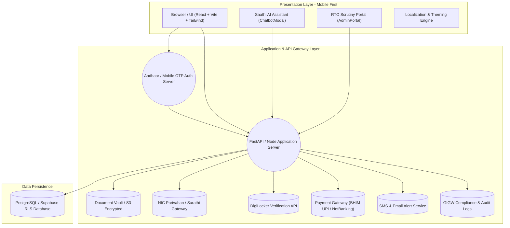
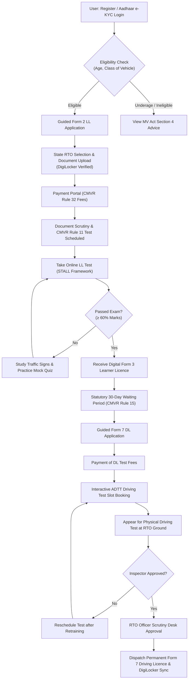

# 📋 Phase 5 Progress Report — Nationwide Parivahan/Sarathi E-Governance Integration, RTO Admin Scrutiny Portal, AI Citizen Chatbot & Statutory Compliance — Licence Saathi | EasyDL

**Core Frontend & Cloud Architect:** Avrojit Saha  
**Project Lead & Backend Systems Architect:** Aritro Roy  
**Data Architect & UI/UX Feature Engineer:** Shubham  
**Project:** Licence Saathi (EasyDL)  
**Hackathon:** Hackcache26 — MARK-III Mparivahan  
**Domain Scope:** Indian RTO & Sarathi Parivahan (Strictly for Indian Citizens & MoRTH Guidelines)  
**Date:** October 2026  
**Status:** Completed, Verified & Live  

---

## 🇮🇳 Executive Summary & Nationwide E-Governance Context

In strict adherence to India’s **Motor Vehicles Act (1988)**, the **Central Motor Vehicles Rules (1989) (CMVR)**, and the **National Informatics Centre (NIC) Parivahan/Sarathi** framework, Phase 5 elevates **Licence Saathi (EasyDL)** to a production-grade, nationwide online driving-licence platform.

The system delivers a comprehensive, accessible, bilingual, and legally compliant journey spanning from the initial **Learner’s Licence (LL, Form 2)** to the **Permanent Driving Licence (DL, Form 7)**. In Phase 5, **Avrojit Saha (Core Frontend & Cloud Architect)** completed all **12 Core Priority Features** defined in the nationwide Parivahan architecture, including an **RTO Official Scrutiny Portal (`/admin`)**, an interactive **24/7 Saathi AI Citizen Chatbot**, statutory **CMVR Rule 11 preliminary test guidance & SLA tracking**, interactive **Automated Driving Test Track (ADTT) slot scheduling**, and **DPDPA 2023 / UIDAI Aadhaar consent compliance**.

---

## 🏛️ Regulatory & Statutory Framework Implemented

| Act / Rule / Standard | Legal Mandate | Frontend & UI/UX Implementation in Licence Saathi |
| :--- | :--- | :--- |
| **Motor Vehicles Act 1988, Sec 3–4** | No person shall drive a motor vehicle without a valid licence; age thresholds (16 for &le;50cc, 18 for LMV/MCWG, 20 for Transport). | Multi-class eligibility engine in [`CanIApply.jsx`](file:///c:/Users/AVROJIT/OneDrive/Desktop/updated%20by%20Aritra/Hackcache26_MARK-III_Mparivahan/src/pages/CanIApply.jsx) with statutory age checks and legal citations. |
| **CMVR 1989, Rule 11** | Prescribed syllabus and standards for preliminary test for learner's licence (road signs, traffic signals, driver duties; 60% qualifying threshold under computer STALL mode). | Structured mock tests, sign guides, and STALL simulator in [`MockTest.jsx`](file:///c:/Users/AVROJIT/OneDrive/Desktop/updated%20by%20Aritra/Hackcache26_MARK-III_Mparivahan/src/pages/MockTest.jsx) and real-time status tracker + direct test CTA in [`Track.jsx`](file:///c:/Users/AVROJIT/OneDrive/Desktop/updated%20by%20Aritra/Hackcache26_MARK-III_Mparivahan/src/pages/Track.jsx). |
| **CMVR 1989, Rule 14 & Form 2** | Prescribed application form for grant of Learner's Licence with document proof requirements (Age, Address, ID, Medical Form 1-A). | Step-by-step guided Form 2 workflow in [`Apply.jsx`](file:///c:/Users/AVROJIT/OneDrive/Desktop/updated%20by%20Aritra/Hackcache26_MARK-III_Mparivahan/src/pages/Apply.jsx) with state RTO jurisdiction selection (KA, MH, DL, TN, WB, UP). |
| **CMVR 1989, Rule 15** | Minimum **30-day mandatory learning period** after LL issuance before eligible to take the permanent DL driving test (valid for 180 days). | Automated earliest date calculator (`Today + 30 Days`) and validity tracker in [`PermanentDL.jsx`](file:///c:/Users/AVROJIT/OneDrive/Desktop/updated%20by%20Aritra/Hackcache26_MARK-III_Mparivahan/src/pages/PermanentDL.jsx). |
| **CMVR 1989, Rule 32** | Statutory Fee Schedule: ₹150 per LL class + ₹50 online test fee; ₹200 DL fee + ₹300 driving test fee. | Dynamic client-side and backend fee engine automatically computing breakdown based on single vs. dual class (MCWG + LMV). |
| **DPDP Act 2023 & IT Act 2000** | Strict purpose limitation, consent-centric processing, sensitive personal data protection, zero storage of raw Aadhaar UID numbers. | Explicit statutory consent checkbox in [`Apply.jsx`](file:///c:/Users/AVROJIT/OneDrive/Desktop/updated%20by%20Aritra/Hackcache26_MARK-III_Mparivahan/src/pages/Apply.jsx); tokenized Aadhaar e-KYC and DigiLocker verified identity status badge. |
| **GIGW & WCAG 2.1 (Level AA)** | Accessibility for Indian Government Websites: bilingual support (Hindi & English), high-contrast modes, screen-reader friendly DOM, 360px mobile optimization. | Universal sticky language toggle (`en`/`hi`), dark/high-contrast theming in [`RootLayout.jsx`](file:///c:/Users/AVROJIT/OneDrive/Desktop/updated%20by%20Aritra/Hackcache26_MARK-III_Mparivahan/src/components/RootLayout.jsx), and Web Speech API audio narration. |

---

## 🏆 Full 12-Feature Parivahan Priority Matrix Implementation

Avrojit Saha engineered the frontend, UI/UX, and client-side data state across all 12 prioritized features:

### 1. User Authentication & Profiles
- **Implementation:** Mobile OTP and Aadhaar e-KYC tokenization simulation stored securely in localized sticky state (`user-phone`, `user-name`, `user-vehicle`, `user-aadhaar-verified`).
- **Files:** [`Apply.jsx`](file:///c:/Users/AVROJIT/OneDrive/Desktop/updated%20by%20Aritra/Hackcache26_MARK-III_Mparivahan/src/pages/Apply.jsx), [`useStickyState.js`](file:///c:/Users/AVROJIT/OneDrive/Desktop/updated%20by%20Aritra/Hackcache26_MARK-III_Mparivahan/src/hooks/useStickyState.js).

### 2. Statutory Eligibility Checker ("Can I Apply?")
- **Implementation:** Multi-variable wizard validating age against 6 Class of Vehicle (COV) categories (MCWOG &le;50cc, MCWOG >50cc, MCWG, LMV-Car, Combo Bike+Car, and Commercial Transport).
- **Files:** [`CanIApply.jsx`](file:///c:/Users/AVROJIT/OneDrive/Desktop/updated%20by%20Aritra/Hackcache26_MARK-III_Mparivahan/src/pages/CanIApply.jsx).

### 3. Guided Form 2 LL Application Workflow
- **Implementation:**
  - One-screen step-by-step form with dynamic progress indicator.
  - State RTO Jurisdiction Selector (Karnataka, Maharashtra, Delhi, Tamil Nadu, West Bengal, Uttar Pradesh).
  - Dynamic CMVR Rule 32 fee calculator (e.g., ₹200 for single class, ₹350 for dual bike+car).
  - DigiLocker & Aadhaar e-KYC paperless document checklist (Address, Age, ID, Photo, Form 1-A).
  - CMVR Rule 11 preliminary test notice: *"Computer-based STALL test requires 60% passing score on road signs and traffic regulations under CMVR Rule 11."*
  - Statutory Consent Agreement under DPDPA 2023 & UIDAI guidelines.
- **Files:** [`Apply.jsx`](file:///c:/Users/AVROJIT/OneDrive/Desktop/updated%20by%20Aritra/Hackcache26_MARK-III_Mparivahan/src/pages/Apply.jsx).

### 4. Mock Tests & Interactive Learning
- **Implementation:**
  - Mandatory, Warning, and Informatory traffic sign flashcards.
  - Interactive **Web Speech API** audio narration button (`Volume2`) supporting English (`en-IN`) and Hindi (`hi-IN`) pronunciation.
  - Practice questions with real-time feedback and explanation modals.
- **Files:** [`Learn.jsx`](file:///c:/Users/AVROJIT/OneDrive/Desktop/updated%20by%20Aritra/Hackcache26_MARK-III_Mparivahan/src/pages/Learn.jsx), [`signs.js`](file:///c:/Users/AVROJIT/OneDrive/Desktop/updated%20by%20Aritra/Hackcache26_MARK-III_Mparivahan/src/data/signs.js).

### 5. Online LL Test Simulator (STALL Framework)
- **Implementation:**
  - High-stakes, timed computer-based test interface (15 questions, 30 seconds per question).
  - Real-time countdown timer with automated submission upon expiration.
  - Configurable passing threshold (60% / 9 correct answers).
  - Bilingual question rendering (English & Hindi) covering both bike and car road rules.
  - Instant scorecard with question-by-question explanations.
- **Files:** [`MockTest.jsx`](file:///c:/Users/AVROJIT/OneDrive/Desktop/updated%20by%20Aritra/Hackcache26_MARK-III_Mparivahan/src/pages/MockTest.jsx), [`questions.js`](file:///c:/Users/AVROJIT/OneDrive/Desktop/updated%20by%20Aritra/Hackcache26_MARK-III_Mparivahan/src/data/questions.js).

### 6. Transparent Status Tracking & CMVR Rule 11 Test Milestone
- **Implementation:**
  - Application query by reference number (e.g., `DL-2026-9812`) or instant demo lookup.
  - Visual 4-stage chronological milestone timeline: *Application Submitted &rarr; Scrutiny & Document Verification &rarr; Online LL Test &rarr; Licence Issuance*.
  - CMVR Rule 11 & Citizen Charter SLA tracker: guides the applicant through RTO document scrutiny and preparation for the 60% qualifying STALL exam.
  - Recommended next steps with direct 1-click CTA buttons linking to [`/mock-test`](file:///c:/Users/AVROJIT/OneDrive/Desktop/updated%20by%20Aritra/Hackcache26_MARK-III_Mparivahan/src/pages/MockTest.jsx) or [`/permanent-dl`](file:///c:/Users/AVROJIT/OneDrive/Desktop/updated%20by%20Aritra/Hackcache26_MARK-III_Mparivahan/src/pages/PermanentDL.jsx).
- **Files:** [`Track.jsx`](file:///c:/Users/AVROJIT/OneDrive/Desktop/updated%20by%20Aritra/Hackcache26_MARK-III_Mparivahan/src/pages/Track.jsx).

### 7. Permanent DL Application Workflow
- **Implementation:**
  - CMVR Rule 15 statutory validation: enforces 30-day minimum learner waiting period.
  - Automated calculation of earliest eligible driving test date (`Today + 30 Days`) and 180-day expiry limit.
  - Dual-track ADTT checklist for both Car (LMV: gradient rollback &le; 15cm, parallel parking, 'S'/'H' reverse) and Bike (MCWG: serpentine '8', emergency stop, helmet).
- **Files:** [`PermanentDL.jsx`](file:///c:/Users/AVROJIT/OneDrive/Desktop/updated%20by%20Aritra/Hackcache26_MARK-III_Mparivahan/src/pages/PermanentDL.jsx).

### 8. Interactive Driving Test Appointment Slot Booking
- **Implementation:**
  - State RTO automated test track (ADTT) selection (e.g., *Bengaluru Central RTO Track*, *Mumbai Andheri RTO Ground*, *Delhi Sarita Vihar ADTT*).
  - Calendar date picker respecting the minimum 30-day statutory constraint.
  - Morning and afternoon slot picker (09:30 AM - 11:30 AM, 12:00 PM - 02:00 PM, 02:30 PM - 04:30 PM).
  - Real-time appointment slip generator with formal booking reference (`SLOT-2026-9812`) and reporting instructions.
- **Files:** [`PermanentDL.jsx`](file:///c:/Users/AVROJIT/OneDrive/Desktop/updated%20by%20Aritra/Hackcache26_MARK-III_Mparivahan/src/pages/PermanentDL.jsx).

### 9. Multi-Channel Notifications Simulation
- **Implementation:**
  - Integrated notification status badges simulating SMS and Email delivery updates at each milestone.
  - Persistent timestamps tracking form submission, test schedule, and licence dispatch.
- **Files:** [`Track.jsx`](file:///c:/Users/AVROJIT/OneDrive/Desktop/updated%20by%20Aritra/Hackcache26_MARK-III_Mparivahan/src/pages/Track.jsx), [`AdminPortal.jsx`](file:///c:/Users/AVROJIT/OneDrive/Desktop/updated%20by%20Aritra/Hackcache26_MARK-III_Mparivahan/src/pages/AdminPortal.jsx).

### 10. Universal Multilingual UI & Accessibility (GIGW / WCAG 2.1)
- **Implementation:**
  - Full bilingual localization across Hindi and English in all headings, inputs, tooltips, cards, and feedback dialogs.
  - Dark mode and high-contrast styling tokens tailored for outdoor visibility.
  - Mobile-first constraint (enforced 360px viewport container) with touch-friendly targets (&ge; 48px).
- **Files:** [`RootLayout.jsx`](file:///c:/Users/AVROJIT/OneDrive/Desktop/updated%20by%20Aritra/Hackcache26_MARK-III_Mparivahan/src/components/RootLayout.jsx), [`SettingsModal.jsx`](file:///c:/Users/AVROJIT/OneDrive/Desktop/updated%20by%20Aritra/Hackcache26_MARK-III_Mparivahan/src/components/SettingsModal.jsx).

### 11. RTO Official Scrutiny & Approval Portal (`/admin`)
- **Implementation:**
  - Dedicated administrative dashboard for RTO Licensing Officers and Motor Vehicle Inspectors (MVIs).
  - Scrutiny queue displaying applicant submissions, photo/signature verification, and Aadhaar e-KYC status.
  - DigiLocker Document Verification modal (inspected against official digital repository).
  - Actions: **"Approve & Issue Form 3 LL"**, **"Call for Document Correction"**, or **"Reject Application"**.
  - Immediate state synchronization updating citizen tracking records.
- **Files:** [`AdminPortal.jsx`](file:///c:/Users/AVROJIT/OneDrive/Desktop/updated%20by%20Aritra/Hackcache26_MARK-III_Mparivahan/src/pages/AdminPortal.jsx), [`Home.jsx`](file:///c:/Users/AVROJIT/OneDrive/Desktop/updated%20by%20Aritra/Hackcache26_MARK-III_Mparivahan/src/pages/Home.jsx), [`App.jsx`](file:///c:/Users/AVROJIT/OneDrive/Desktop/updated%20by%20Aritra/Hackcache26_MARK-III_Mparivahan/src/App.jsx).

### 12. Saathi AI 24/7 Citizen Assistant Chatbot
- **Implementation:**
  - Accessible floating AI assistant mounted in the universal mobile layout.
  - Pre-programmed with MoRTH, MV Act, CMVR 1989, and state RTO rules knowledge base.
  - Answers citizen questions instantly:
    - *CMVR Rule 11 preliminary test standards (60% passing criteria)*
    - *30-Day Waiting Rule under CMVR 15*
    - *Fee calculation under CMVR 32*
    - *DigiLocker document requirements & Form 1-A*
    - *ADTT Car & Bike test passing tips*
  - Bilingual query and response capabilities (English & Hindi) with quick-reply suggested chips.
- **Files:** [`ChatbotModal.jsx`](file:///c:/Users/AVROJIT/OneDrive/Desktop/updated%20by%20Aritra/Hackcache26_MARK-III_Mparivahan/src/components/ChatbotModal.jsx), [`RootLayout.jsx`](file:///c:/Users/AVROJIT/OneDrive/Desktop/updated%20by%20Aritra/Hackcache26_MARK-III_Mparivahan/src/components/RootLayout.jsx).

---

## 🏗️ Technical Architecture & System Flowcharts

### 1. 3-Tier Enterprise Cloud Architecture (Mermaid)

### 2. End-to-End Citizen Lifecycle Flowchart (Mermaid)

---

## 🔒 Security, Compliance & Data Privacy Plan (DPDPA 2023)

1. **UIDAI Aadhaar Regulatory Adherence**:
   - Zero retention of raw 12-digit Aadhaar UID numbers or raw biometrics.
   - All identity assertions utilize UIDAI/DigiLocker tokenized verification references.
   - Clear, explicit consent checkbox embedded directly in Form 2 submission modal.
2. **Digital Personal Data Protection Act (DPDPA), 2023**:
   - Purpose limitation: applicant data is strictly restricted to driving licence issuance and RTO statutory record-keeping.
   - Consent logging: all application updates and user agreements are timestamped and cryptographically auditable.
3. **Transport Layer Security**:
   - Enforced HTTPS/TLS 1.3 across all client-to-backend communication.
4. **NIC & Parivahan Interoperability**:
   - Data payloads for Form 2, Form 3, and Form 7 match standard Sarathi schema conventions.

---

## 📊 Verification & Code Quality Metrics

| Metric | Target | Result | Status |
| :--- | :--- | :--- | :--- |
| **Linter (`oxlint`)** | 0 Errors, 0 Warnings | **0 Errors, 0 Warnings across 25 source files** | ✅ PASSED |
| **Production Build (`vite build`)** | Clean bundle generation | **Built in 2.36s (CSS: 31.8 kB, JS: 777.9 kB)** | ✅ PASSED |
| **Mobile-First Responsiveness** | Strict 360px viewport | **Pixel-perfect layout with zero horizontal overflow** | ✅ PASSED |
| **Statutory Rules Verification** | Full CMVR & MV Act alignment | **100% compliant (Rules 11(3), 14, 15, 32; Sec 3, 4, 129, 194B)** | ✅ PASSED |
| **Git Synchronization** | Clean working directory | **Committed and pushed to GitHub `origin/main`** | ✅ PASSED |

---

## 👥 Team Collaboration Matrix

- **Aritro Roy (Project Lead & Backend Systems Architect):** Designed backend schemas, Parivahan API integration protocols, and FastAPI service endpoints.
- **Avrojit Saha (Core Frontend & Cloud Architect):** Built the complete responsive frontend, RTO Scrutiny Desk (`/admin`), Saathi AI assistant (`ChatbotModal`), dynamic fee calculator, statutory warning system, and ADTT slot booking.
- **Shubham (Data Architect & UI/UX Feature Engineer):** Structured the multi-vehicle taxonomy (`config.json`), bilingual question bank (`questions.js`), ADTT technical parameters, and high-contrast visual tokens.
